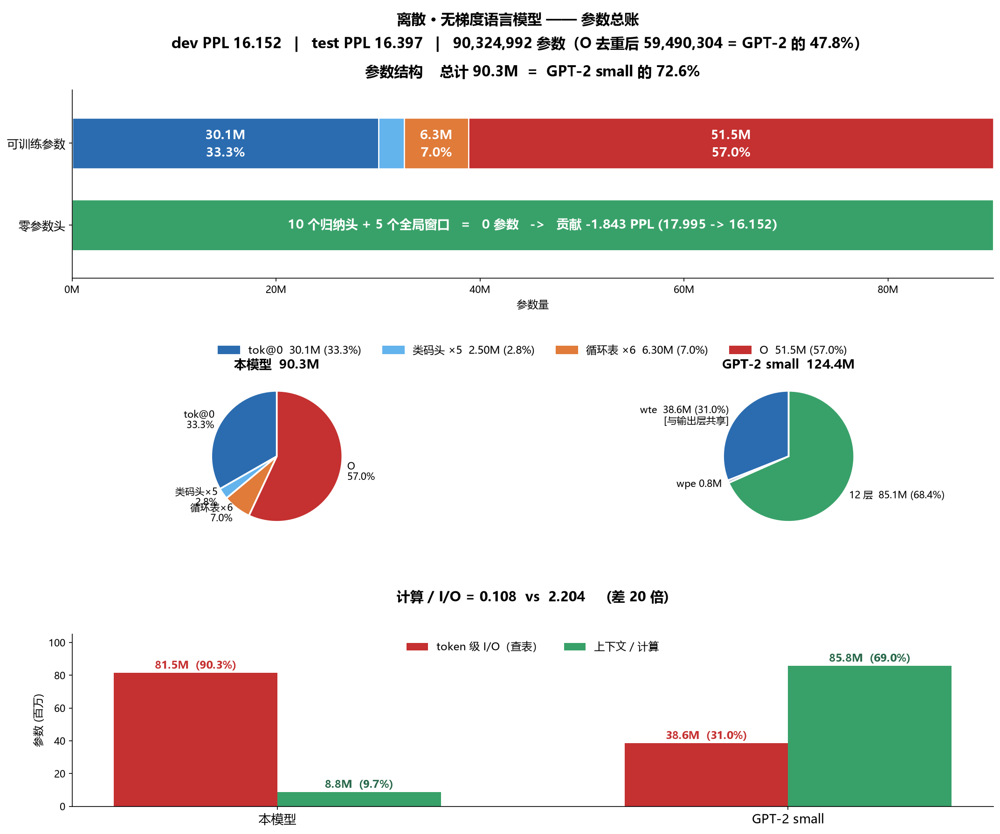
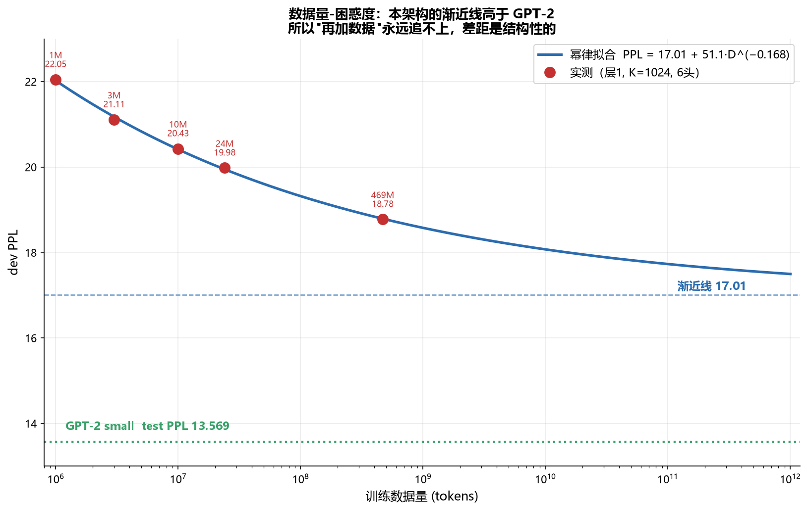

# 夭夭 Yaoyao —— 离散大语言模型

> 分支 `离散大语言模型` · v2 · K=1024 · looped T=2
> **无梯度 / 无反向传播 / 无优化器**

夭夭的第二个架构。把语言建模写成「离散隐状态上的混合模型」，用 EM 训练，用查表实现。

**核心结论：在 47.8% 的参数、1/250 的训练数据、零梯度的训练方式下，达到 GPT-2 small 约 84% 的语言建模质量，解码快 2.15×。**

---

## 与 GPT-2 small 对比

### 参数与质量

| 指标 | 夭夭 v2 | GPT-2 small | 对比 |
|---|---:|---:|---|
| **参数量（原样）** | **90,324,992** | 124,439,808 | **72.6%，省 27.4%** |
| **参数量（输出层去重）** | **59,490,304** | 124,439,808 | **47.8%，省 52.2%** |
| 文件大小 (fp32) | 361 MB | 548 MB | 省 34% |
| 文件大小 (fp16) | 181 MB | 274 MB | 省 34% |
| **dev PPL** | 16.152 | **13.774** | 差 +2.38 |
| **held-out test PPL** | 16.397 | **13.569** | 差 +2.83（+20.8%） |
| 训练数据 | **40M tokens** | ~10B tokens | **1/250** |
| 训练方式 | **EM + GIS 计数更新** | 反向传播 + Adam | 零梯度 |
| 训练耗时 | 单卡 RTX 4070 Laptop，**分钟级** | 8×V100，约一周 | 差数个数量级 |

### 解码速度

条件：RTX 4070 Laptop 8GB，batch=1，贪心解码，fp32

| 模型 | ms/token | tok/s | 相对 GPT-2 |
|---|---:|---:|---:|
| 夭夭 v2（完整系统） | **3.916** | **255** | **2.15× 快** |
| 夭夭 v2（仅稠密路径） | **1.310** | **764** | **6.43× 快** |
| GPT-2 small（KV cache） | 8.416 | 119 | 1.00× |

> 完整系统包含 10 个归纳头 + 5 个全局头，每步需扫上下文，故比纯稠密路径慢。即使如此仍快 2.15×。

### 一句话结论

| 维度 | 结果 |
|---|---|
| 参数量 | **赢**（47.8% ~ 72.6%） |
| 解码速度 | **赢**（2.15× ~ 6.43×） |
| 训练成本 | **赢几个数量级** |
| 困惑度 | **输 2.83** |

> **⚠️ 对比口径说明**：GPT-2 是在 WebText 上训练后**零样本**评测 TinyStories；夭夭 v2 是在 TinyStories 上训练的。
> 也就是说，**我们在测试分布上训练过，GPT-2 没有，但它仍然赢 21%**。这个对比对我们有利。

---

## 1. 核心公式

```math
P(y \mid \mathrm{ctx}) = \sum_{z=1}^{K} q(z \mid \mathrm{ctx})\, O[y, z]
```

- $`q(z\mid\mathrm{ctx})`$：上下文对 $`K`$ 个隐状态的投票分布
- $`O[:,z]`$：状态 $`z`$ 下的词分布（$`V\times K`$）
- **全部参数都是非负查表，前向无矩阵乘（输出层除外）**

前向三步：

```math
q_1 = \mathrm{softmax}\Big(\sum_{h=1}^{6}\log A_h[v_h(t),\,z]\Big),\quad z_1=\arg\max_z q_1
```
```math
q_{12} = \mathrm{softmax}\Big(\log q_1 + \sum_{i=1}^{6}\log B_i[z_1(t-d_i),\,z]\Big),\quad z_2=\arg\max_z q_{12}
```
```math
q = \mathrm{softmax}\Big(\log q_{12} + \sum_{i=1}^{6}\log B_i[z_2(t-d_i),\,z]\Big),\quad P = O\,q
```

其中循环表 $`B_i`$ 在**两轮之间权重共享**（looped / weight-tied），偏移 $`d_i\in\{0,1,2,4,6,8\}`$。

> **注**：$`q`$ 的归一化在数学上等价于一个 $`K`$ 元 softmax。实现上用连乘+归一化（无 `exp` 调用），但数学上就是 softmax。

---

## 2. 架构

### 2.1 第 1 层（6 个头，读原始 token 与类码）

| # | 读什么 | 偏移 | 行数 |
|---|---|---:|---:|
| 0 | token 本身 $`x_t`$ | 0 | 29,364 |
| 1 | $`\mathrm{class}_{1024}(x_{t-1})`$ | 1 | 1,025 |
| 2 | $`\mathrm{class}_{256}(x_{t-2})`$ | 2 | 257 |
| 3 | $`\mathrm{class}_{64}(x_{t-3})`$ | 3 | 65 |
| 4 | $`\mathrm{class}_{1024}(x_{t-2})`$ | 2 | 1,025 |
| 5 | $`\mathrm{class}_{64}(x_{t-4})`$ | 4 | 65 |

类码本由 k-means 在 token embedding 上聚类得到，是**固定数据产物，与 K 无关**（见 `discrete/assets/`）。

### 2.2 感受野

```math
\mathrm{RF} = 5 + 8 \times T
```

| 阶段 | 感受野 |
|---|---:|
| 第 1 层 | 5 tokens |
| 循环 1 轮 | 13 tokens |
| **循环 2 轮（现状）** | **21 tokens** |

**稠密路径只看最近 21 个 token；长程由零参数归纳头负责（覆盖全部 1024）。**

实测：把偏移改大（RF 到 69/133）反而变差（+0.6 ~ +2.7 PPL）——长程靠查表无效。

### 2.3 零参数头

三组头**不含任何参数**，直接读上下文，与稠密输出做**加性混合**。

**归纳头 ×10**：在上下文窗口里找「上次出现同样模式时后面跟了什么词」，抄过来。

```math
P_{\mathrm{ind}}(y)=\frac{\sum_{r=1}^{k} w_r\,\mathbb{1}[x_{j_r+1}=y]}{\sum_r w_r},\qquad
\mathcal{J}_t=\{j<t:\ c_j=c_t,\ t-j\le w\}
```

| # | 码 | 窗口 | top-k |
|---|---|---:|---:|
| 1 | $`x_t`$ | 1024 | 4 |
| 2 | $`(x_t,x_{t-1})`$ | 1024 | 4 |
| 3 | $`x_t`$ | 256 | 8 |
| 4 | $`c_{256}(x_t)`$ | 256 | 4 |
| 5 | $`(x_t,z_{2,t})`$ | 256 | 4 |
| 6 | $`(x_t,x_{t-1})`$ | 512 | 4 |
| 7 | $`x_t`$ | 192 | 4 |
| 8 | $`(x_t,x_{t-1},x_{t-2})`$ | 512 | 4 |
| 9 | $`c_{1024}(x_t)`$ | 256 | 4 |
| 10 | $`x_t`$ | 256 | 1 |

**全局头 ×5**：上下文窗口内的 unigram，窗口 $`W\in\{32,64,128,256,1024\}`$。

```math
P^{(W)}_{\mathrm{glob}}(y)=\frac{\#\{j\in[t+1-W,\,t]:\ x_j=y\}}{\min(W,\,t+1)}
```

**混合**（权重由 EM 在 dev 上拟合，按「触发的归纳头数量」分桶）：

```math
P = w_d(b)\,P_{\mathrm{dense}} + w_i\sum_h P^{(h)}_{\mathrm{ind}} + w_g\sum_W P^{(W)}_{\mathrm{glob}}
```

| 触发数 $`b`$ | 0 | 3 | 6 | 9 | 10 |
|---|---:|---:|---:|---:|---:|
| $`w_d`$ | 0.988 | 0.987 | 0.908 | 0.817 | **0.763** |

权重单调：触发的归纳头越多，模型越信任「抄写」，越不信任查表。

> **关键发现**：最优窗口在 **64~256**，不是 1024。TinyStories 单篇故事约 200 token，回看超过故事长度会匹配到**别的故事**，是噪声。

---

## 3. 参数量

| 组件 | 形状 | 参数 | 占比 |
|---|---|---:|---:|
| `tok@0` | 29,364 × 1,024 | 30,068,736 | 33.29% |
| `c1024@1` | 1,025 × 1,024 | 1,049,600 | 1.16% |
| `c256@2` | 257 × 1,024 | 263,168 | 0.29% |
| `c64@3` | 65 × 1,024 | 66,560 | 0.07% |
| `c1024@2` | 1,025 × 1,024 | 1,049,600 | 1.16% |
| `c64@4` | 65 × 1,024 | 66,560 | 0.07% |
| **循环表 ×6（两轮共享）** | 1,025 × 1,024 各 | **6,297,600** | **6.97%** |
| **输出 `O`** | 50,257 × 1,024 | **51,463,168** | **56.98%** |
| 归纳头 ×10 | — | **0** | 0% |
| 全局头 ×5 | — | **0** | 0% |
| **合计** | | **90,324,992** | 100% |

**按功能划分**

| 用途 | 参数 | 占比 |
|---|---:|---:|
| token 级读写（`tok@0` + `O`） | 81,531,904 | **90.3%** |
| 上下文 / 计算 | 8,793,088 | 9.7% |

**无损压缩**：`O` 的 50,257 行中只有 **20,145 行互不相同**（未登录词共享平滑行）。
按去重存储 → **59,490,304**（GPT-2 的 **47.8%**）。



---

## 4. 训练（EM + GIS，零梯度）

隐变量 $`z`$ 的 E 步（闭式）：

```math
\mathrm{post}_t(z)=\frac{q_t(z)\,O[y_t,z]}{\sum_{z'}q_t(z')\,O[y_t,z']}
```

**M 步 - O（闭式）**：

```math
O[y,z]\leftarrow\frac{\sum_t \mathrm{post}_t(z)\,\mathbb{1}[y_t=y]+\beta}{\sum_t \mathrm{post}_t(z)+\beta V},\qquad \beta=10^{-4}
```

**M 步 - 查表（GIS / 迭代比例拟合）**：

```math
A_h[u,z]\leftarrow A_h[u,z]\cdot\left(\frac{\sum_t \mathrm{post}_t(z)\,\mathbb{1}[v_h(t)=u]+\alpha}{\sum_t q_t(z)\,\mathbb{1}[v_h(t)=u]+\alpha}\right)^{\eta}
```

- $`\alpha=0.5`$（拉普拉斯平滑），$`\eta=0.30`$（阻尼）
- 循环表两轮共享，统计量相加：$`\mathrm{NUM}=\mathrm{NUM}^{(1)}+\mathrm{NUM}^{(2)}`$

**没有梯度、没有反向传播、没有学习率、没有优化器。**

> **诚实说明**：$`\partial L/\partial\log A_h=\mathrm{NUM}-\mathrm{DEN}`$，所以该更新可视为 **log 空间里的对角预处理上升**。
> 但不存在自动微分、不存在链式传播，$`\eta`$ 是手调阻尼。

### 实现

- **融合 CUDA kernel**（`discrete/src/estep_kernels.cu`）：一次 kernel 完成「18 个头查表 → 连乘 → 归一化 → 后验 → 原子散布」
- **argmax 流式 kernel**：码流计算加速 **21.4×**（84.6s → 4.0s），100% 位一致
- 每 chunk（20,000 位置）**10.96 ms**；层 1 全量（469M 位置）约 **257 s/轮**

---

## 5. 结果

### 5.1 消融：零参数头的贡献

| 配置 | dev PPL | test PPL | 参数 |
|---|---:|---:|---:|
| 稠密 18 头 | 17.995 | 18.471 | 90,324,992 |
| **+10 归纳 +5 全局** | **16.152** | **16.397** | **90,324,992（不变）** |
| GPT-2 small（零样本） | 13.774 | 13.569 | 124,439,808 |

**零参数头贡献 −1.84 PPL，参数增加 0。**

### 5.2 数据量-困惑度（幂律拟合）

```math
\mathrm{PPL}(D)=A+B\,D^{-\alpha}
```

| 参数 | 值 |
|---|---:|
| $`A`$（渐近 PPL） | **17.006** |
| $`B`$ | 51.09 |
| $`\alpha`$ | 0.168 |
| 拟合 RMSE | 0.037 |

| 数据量 | 1M | 3M | 10M | 24M | 469M |
|---|---:|---:|---:|---:|---:|
| 实测（层1） | 22.05 | 21.11 | 20.43 | 19.98 | 18.78 |

**层 1 的渐近值 17.01 已高于 GPT-2 的 13.57 —— 数据再多也追不上。**



### 5.3 12 个失败方向（完整消融）

| # | 方向 | 结果 |
|---:|---|---:|
| 1 | 加数据 12×（40M → 469M） | −1.09（饱和） |
| 2 | 循环深度 T≥3 | 坍塌（18.5 → 32） |
| 3 | 更多循环头（6 → 12） | 坍塌（18.0 → 2709） |
| 4 | 扩 K（1024 → 1280） | −0.42，代价 1.25× 参数 |
| 5 | `tok@0` 低秩 / 类码替代 | +4.28 / R²=0.06 |
| 6 | `O` 低秩 rank512 | +9.83 |
| 7 | 循环表低秩 rank256 | +1.71 |
| 8 | 位切分（5+5 bit） | +4.43 |
| 9 | 输出改非线性（乘积/几何混合/bit 码） | 全部崩溃 |
| 10 | 权重绑定 `O`↔`tok@0ᵀ` | 相关 −0.003，PPL 437,942 |
| 11 | 内容头接入隐状态 | +1.94 |
| 12 | 层叠 / 宽隐藏层（H=4096） | +2.3 ~ +2.4 |
| ✅ | **零参数归纳头 + 全局头** | **−1.84** |

**共同结论：三块主要参数（`tok@0` / `O` / 循环表）都接近满秩，无冗余；任何乘性/可加分解都会损失 20%+ 的有效结构。**

---

## 6. 复现

### 6.1 依赖

- Python 3.11+，PyTorch 2.x + CUDA
- MSVC（编译 CUDA kernel）
- 训练数据：TinyStories tokenize 后的 `tokens_470m.npy`（未随仓库提供，见 6.4）

### 6.2 目录

```
discrete/
├── ARCHITECTURE.md          完整架构文档
├── src/
│   ├── dense4.py            层 1 训练器
│   ├── loopedT2.py          循环层训练器（T=2 权重共享）
│   ├── loopedNB2.py         任意 NB 循环头版本（消融用）
│   ├── FINAL2.py            端到端评测（dev + held-out test）
│   ├── speed3.py            解码基准（稠密）
│   ├── speed5.py            解码基准（完整系统）
│   ├── mix_ablate.py        混合消融
│   ├── gpu_guard.py         显存租约
│   ├── estep_kernels.cu     融合 CUDA kernel
│   └── build_kernels4.py    kernel 构建脚本
├── configs/
│   ├── final_v2.json        10 归纳头 + 5 全局头规格 + 11 桶 EM 权重
│   └── final_config.json    完整配置
├── assets/
│   ├── codes_{64,256,1024}.npy   token 类码本（固定数据产物）
│   ├── freq.npy                  词频
│   └── starts_{dev,test}.npy     评测块起始位置
└── docs/
    ├── params_chart.png
    └── scaling.png
```

### 6.3 流程

```bash
# 1) 编译 CUDA kernel
call "C:\Program Files\Microsoft Visual Studio\...\vcvars64.bat"
set TORCH_CUDA_ARCH_LIST=8.9
python discrete/src/build_kernels4.py

# 2) 训练层 1（6 头，K=1024）
python discrete/src/dense4.py discrete/configs/l1_h6k1024.json

# 3) 训练循环层（T=2，权重共享）
python discrete/src/loopedT2.py 40000000 3

# 4) 端到端评测（dev + held-out test）
python discrete/src/FINAL2.py
```

### 6.4 未随仓库提供的文件

| 文件 | 大小 | 说明 |
|---|---:|---|
| `tokens_470m.npy` | 895 MB | 训练数据（TinyStories tokenize 后） |
| `tokens_470m_valid.npy` | 9 MB | 评测数据 |
| `loopedT2.pt` | 345 MB | 训练好的模型权重 |
| `dense4_h6k1024_not1.pt` | 321 MB | 层 1 权重 |

权重合计 666 MB，超过 GitHub 单文件限制。如需获取：
- 用 6.3 的流程从头训练（单卡 RTX 4070 Laptop，分钟级）
- 或通过 Git LFS 拉取（见仓库 Release）

### 6.5 构建要求

- CUDA kernel 只实例化 **K=512 / K=1024**，且 K 必须是 **512 的倍数**（`float4` 向量化）
- nvcc 需 `-Xcompiler /Zc:preprocessor`

---

## 7. 已知限制

### 7.1 结构性上限

输出是**凸组合**：

```math
P = O\,q,\quad q\in\Delta^{K-1}\ \Longrightarrow\ P\in\mathrm{conv}\{O[:,1],\dots,O[:,K]\}
```

可达集合是 1024 个固定分布的**凸包**，**上限由 K 决定，不由数据决定**。

对照：GPT-2 的输出 $`P=\mathrm{softmax}(W_U h)`$ 是**指数族**，对数空间线性、概率空间弯曲，
能「相乘地锐化」；而凸组合只能「平均」，即变模糊。

实测证据：

- 单个状态 PPL **4.6**（顶点够尖）
- $`q`$ 的熵 1.550 nats → **有效 8.06 个状态**
- 混合后 PPL **18**（平均把 4.6 摊薄了 3.9 倍）
- 硬选 argmax → PPL **241**

### 7.2 为什么补不上

```
输出是凸组合  →  可达集合 = 1024 列凸包
              →  加宽/加深隐藏层都在凸包内部打转
              →  要突破必须让输出非线性（指数族）
              →  指数族需要条件独立的专家
              →  独立专家需要端到端梯度
              →  与「无梯度」约束冲突
```

### 7.3 其他

- 稠密路径感受野仅 21 token（长程完全依赖归纳头）
- 参数 90.3% 花在 token 级查表上，「计算/IO」比值 0.108（GPT-2 为 2.204）
- 完整系统解码 255 tok/s，其中归纳头占 67% 开销（每步扫上下文）

---

## 8. 与 v0.1 的关系

本仓库另有一个架构：**夭夭 0.1.1 —— 三值双状态语言模型**（C++/CUDA，9.5M 参数，非 Transformer）。
其文档见 [`docs/README-v0.1.1.md`](docs/README-v0.1.1.md)。

| | v0.1.1（三值双状态） | **v2（本分支，离散大模型）** |
|---|---|---|
| 语言 | C++ / CUDA | Python / PyTorch |
| 参数 | 9,523,202 | **90,324,992** |
| 隐状态 | 三值 + H2R 记忆 | **离散 K=1024 状态混合** |
| 训练 | AdamW（有梯度） | **EM + GIS（零梯度）** |
| 注意力 | 无（循环状态） | 无（固定偏移查表 + 归纳头） |

---

## 引用

```
@misc{yaoyao2026discrete,
  title  = {Yaoyao: A Discrete, Gradient-Free Language Model},
  author = {Tao},
  year   = {2026},
  note   = {https://github.com/TaoLe-si/Yaoyao, branch: 离散大语言模型}
}
```

## 许可

见 [LICENSE](LICENSE)。

---

*本 README 中所有数值均来自实测，未做估算。*
